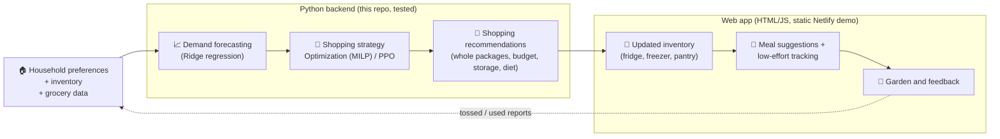

<p align="center">
  
</p>

<p align="center">
  <b>Smarter grocery decisions. Less food waste. One happy little sprout.</b><br>
  <sub>Decide <i>what to buy</i>, <i>what to cook</i> and <i>what to use first</i>, without the spreadsheet.</sub>
</p>

<p align="center">
  <a href="https://groceriq.netlify.app/"></a>
  
  
  
  
</p>

> [!NOTE]
> 🌱 All demand, prices, budgets, storage sizes and results here are **simulated**. Nothing in this repo is a measured saving for a real household.
> The live site is a **static demo** built from precomputed model runs (see [Demo vs. live models](#-demo-vs-live-models)).

---

## 🥕 The problem

We buy more than we use, forget what's already in the fridge, and throw food away, while still running out of the things we actually need.
Planning meals around a budget and the food at home is tedious, so most people skip it. The result: wasted money *and* wasted food.

**Smart Grocery Coach** makes the weekly decision easy, and it's honest about the trade-off between three things:

| 💸 Spend less | 🗑️ Waste less | 🧺 Don't run out |
|:---:|:---:|:---:|

## 🌼 Meet Pip

Pip is the little sprout who lives in your garden 🪴. Low-waste weeks grow **leaves**, badges grow **flowers**, rescued food grows **fruit**, staying on budget **waters the soil**,
and Pip's face follows your weekly *fridge score*. Pip is a motivational prototype: cute, but not (yet!) tested for real behaviour change.

## 🧭 How it works



| Step | Lives in | In the deployed demo |
|---|---|---|
| 📈 Forecasting, Optimization, PPO, constraints, evaluation | Python (`src/`) | Run offline. Outputs for the evaluated household are **precomputed** into `results/ui/plans.json` |
| 🛒 Shopping recommendations API | `src/coach_api.py`, `src/coach_server.py` (tested) | **Not deployed.** The demo shows the precomputed replays instead |
| 🧊 Inventory, meals, receipt/fridge input, barcode, garden | `ui/coach.html` (browser) | ✅ Working; data stays in your browser (localStorage) |
| ✨ AI explanations and photo reading | Netlify Function `netlify/functions/explain.mjs` | ✅ With a server-side API key; otherwise clearly labelled samples |

## ✨ What it can do

Each feature says honestly how finished it is. *Demo* means it works in the browser, no accounts or database.

| | Feature | What it does | Status |
|:---:|---|---|---|
| 🎚️ | **Three shopping modes** | *Save Money & Reduce Waste* → Optimization · *Balanced* → each week the Optimization plan or the RL plan · *Keep My Groceries Stocked* → RL agent with the Ridge forecast | Precomputed replays for one household; others get a labelled in-browser preview. Same priorities in the Python API |
| 🛒 | **Weekly shopping list** | Whole packages that respect budget, storage, diet and allergens, with a "why this item" trace | Tested in Python; precomputed in the demo |
| 🧊 | **Inventory** | Lots in the fridge, freezer and pantry with days left; freezing and thawing modelled in Python | Demo (browser only) |
| 🍲 | **Meal ideas** | Recipes that fit your diet, ranked to use food that expires soon. Missing ingredients are added only if they fit whole packages, the budget and storage, otherwise left off with a note | Demo (rule-based ranking) |
| ⏰ | **Use-first reminders** | Food close to its date is highlighted; "rescues" earn points | Demo |
| 🧾 | **Receipt, order email and fridge photo** | An AI model reads it, you review, and the inventory updates. The app only asks about exceptions ("Did you finish the milk?") | Experimental; needs a server-side key, otherwise samples |
| 📷 | **Barcode and nutrition** | Camera or typed barcodes, looked up in Open Food Facts and checked against diet and allergens | Demo; depends on database coverage |
| 🌱 | **Virtual garden** | Points, weekly check-ins, low-waste weeks and Pip | Motivational prototype |
| 💬 | **Plain-language product explanations** | Gemini (or Claude) explains a product in a few short lines; prompts forbid medical advice and invented numbers | Needs a server-side key; answers are not verified |

> 🤖 **Where AI is used:** our own models (Ridge, Optimization, PPO) plan what to buy. The language model (Gemini, or Claude as a fallback) is only the *reader and explainer*: it turns photos, receipts and labels into data, and explains products in plain words. It never changes the plan.

## 📊 Results

Held-out test: weeks 78–103, household `hh_student` (a student living alone 🎓), Durham NC prices, a $75 weekly budget, two 13-week episodes (mean of the two).
Simulated data with one recorded demand trajectory, so there are no confidence intervals or significance claims. PPO rows are the mean of three training seeds.
Source: `results/final/test/` and [docs/FINAL_RESULTS.md](docs/FINAL_RESULTS.md).

| Method | Reward / episode ↑ | Spend, $/week ↓ | Waste, units / episode ↓ | Waste cost, $/episode ↓ | Unmet demand, units / episode ↓ | Fill rate (value) ↑ |
|---|---:|---:|---:|---:|---:|---:|
| Fixed list | -16.27 | 56.3 | 23.8 | 58.84 | 59.1 | 0.73 |
| Average rule | -15.19 | 70.2 | 50.0 | 124.14 | 23.3 | 0.87 |
| Forecast rule (Ridge) | -15.12 | 71.3 | 50.3 | 128.10 | 22.7 | 0.88 |
| 💸 **Optimization (MILP)** | **-14.09** | 61.3 | **12.3** | **31.23** | 41.6 | 0.85 |
| 🧺 **PPO with forecast** | -14.71 | 70.1 | 36.7 | 97.19 | 23.6 | **0.89** |
| PPO without forecast | -14.91 | 69.6 | 37.1 | 101.96 | 25.2 | 0.88 |
| ⚖️ *Balanced rule (supplementary)* | *-14.16* | *68.6* | *28.0* | *71.69* | *26.1* | *0.90* |

<sub>The balanced rule is what the app's "Balanced" option replays. It was evaluated on these weeks *after* the frozen six-method comparison (with its rule and tolerance fixed beforehand), so it is not part of that comparison.</sub>


### 🍃 The key trade-off

- 💸 **Optimization buys lean:** about **13% less spend** and about **75% less waste** than the average rule, but roughly **79% more demand goes unmet** (fill rate 0.85, falling to 0.83 in the second episode).
- 🧺 **PPO with the Ridge forecast keeps you stocked:** fill rate **0.89**, the highest of the six frozen methods, and about **a quarter less waste**, but it doesn't save money.
- ⚖️ **Nobody wins everything.** The ranking by reward depends on how much running out costs (2× the item price), which is exactly why the app lets *you* pick a priority.
- 📈 The Ridge forecast helps Optimization (which needs it) and slightly helps PPO, but the PPO with/without forecast gap is within the spread of the three seeds.

## 🚀 Quick start

```bash
git clone https://github.com/gulnargasimzada/smart-grocery-rl && cd smart-grocery-rl
pip install -r requirements_all.txt            # app + RL + optimization (Python 3.11+)

python -m pytest tests -q                      # 🧪 all tests (data/forecast_weekly.csv is included)
streamlit run app.py                           # 🌱 the web app, locally
python build_static.py                         # 📦 builds dist/index.html, the static site used on Netlify

python -m src.coach_server --port 8000         # 🛒 the Python recommendation API (POST /recommend)
python -m src.coach_check                      # ✅ runs the API over a validation episode and compares it with the pure models
python -m src.final_eval --verify              # 🔒 checks the frozen evaluation state is unchanged
```

🔑 AI features need `GEMINI_API_KEY` or `ANTHROPIC_API_KEY` as **server-side** environment variables (see `.env.example`). Never put keys in the page.

## 🛠️ Under the hood

<details>
<summary><b>📈 Demand forecasting (Ridge)</b></summary>

Weekly demand per household and product is predicted with **Ridge regression** on lagged demand, moving averages, season and holiday/guest/away flags, with walk-forward training so a week is never predicted by a model that saw it.
Ridge was compared with **XGBoost** on identical features: validation MAE 0.2072 vs 0.2061 purchase units per product-week (WMAPE about 19.7% vs 19.6%), practically equal, so the simpler, more interpretable Ridge won.
The app uses the `no_events` variant (guest/away weeks aren't known in advance). Weeks 4–11 fall back to a 4-week moving average.
Code: `src/forecast.py`, interface and safeguards: `src/forecast_table.py`, [docs/RL_EVALUATION.md](docs/RL_EVALUATION.md).
</details>

<details>
<summary><b>🧊 Simulation environment (GroceryEnv)</b></summary>

`GroceryEnv` (Gymnasium) simulates 13-week episodes for one household: inventory lots with shelf life, a fridge, freezer and pantry with capacities, freezing and thawing without resetting freshness, daily consumption of fractional demand, regional weekly prices,
and a reward that charges consumed food, waste and unmet demand (2× the item price) plus a protein term and a terminal charge for leftover stock. Hard constraints are enforced in code, not by the reward: whole packages, stock cap, storage capacity, weekly budget, diet and allergens.
Waste is *simulated disposal*, not a food-safety statement.
[docs/RL_TECHNICAL_DESIGN.md](docs/RL_TECHNICAL_DESIGN.md), [docs/STORAGE_DATA.md](docs/STORAGE_DATA.md), [docs/REGIONAL_BUDGETS.md](docs/REGIONAL_BUDGETS.md).
</details>

<details>
<summary><b>💸 Optimization (MILP)</b></summary>

Each week a small mixed-integer program (SciPy/HiGHS) chooses the number of packages of every product, weighing purchase cost, expected shortage, expected waste and protein against the forecast, subject to the same constraints as the environment.
Its one parameter (demand uncertainty) was tuned on training weeks only. [docs/OPTIMIZATION.md](docs/OPTIMIZATION.md).
</details>

<details>
<summary><b>🧠 Reinforcement learning (PPO)</b></summary>

Proximal Policy Optimization (Stable-Baselines3) acts through a normalized action wrapper that turns its output into whole-package orders, then through the same constraint pipeline.
A pilot of 300,000 steps and three seeds was trained with and without forecasts; checkpoints were selected on validation weeks only.
[docs/RL_PPO_PILOT.md](docs/RL_PPO_PILOT.md), [docs/RL_MODELLING_RULES.md](docs/RL_MODELLING_RULES.md).
</details>

<details>
<summary><b>🔒 Evaluation protocol</b></summary>

Weeks are split into training (4–63), validation (64–77) and a held-out test (78–103, two 13-week episodes). The test was run **once**, after the models, checkpoints and settings were frozen and hashed.
[docs/COMPARISON.md](docs/COMPARISON.md), [docs/FINAL_EVALUATION.md](docs/FINAL_EVALUATION.md).
</details>

<details>
<summary><b>🔌 Backend API</b></summary>

`CoachAdapter` (`src/coach_api.py`) runs the frozen Optimization and PPO models on the environment and returns one JSON recommendation (shopping list, inventory, forecast, prices, cost, strategy and the rule that chose it).
`src/coach_server.py` serves it over HTTP using only the standard library. [docs/GROCERY_COACH_INTEGRATION.md](docs/GROCERY_COACH_INTEGRATION.md).
</details>

<details>
<summary><b>🎨 Frontend</b></summary>

A single-page interface in plain HTML, CSS and JavaScript (`ui/coach.html`) fed by a JSON payload built in `ui_payload.py`. `app.py` shows it in Streamlit for local use; `build_static.py` produces the static site deployed on Netlify.
AI features go through the Netlify Function `netlify/functions/explain.mjs` (Gemini when `GEMINI_API_KEY` is set, otherwise Claude with `ANTHROPIC_API_KEY`). [docs/UI_INTEGRATION.md](docs/UI_INTEGRATION.md).
</details>

<details>
<summary><b>🗂️ Repository map</b></summary>

| Path | Contents |
|---|---|
| `ui/`, `app.py`, `ui_payload.py`, `build_static.py`, `netlify.toml`, `netlify/functions/` | Frontend: interface, Streamlit host, static build, AI function |
| `export_ui_plans.py`, `results/ui/plans.json` | Precomputed model runs that the static demo displays |
| `src/coach_api.py`, `src/coach_server.py`, `src/coach_check.py` | Python recommendation API (adapter, HTTP server, verification) |
| `src/env.py`, `src/rl_wrapper.py`, `src/policies.py`, `src/evaluate.py`, `src/train_rl.py`, `src/report_rl.py` | Environment, action wrapper, baselines, evaluation, PPO training and report |
| `src/optimization.py`, `src/optimization_eval.py` | MILP policy and its evaluation |
| `src/forecast.py`, `src/forecast_table.py` | Ridge/XGBoost forecasting and the strict forecast interface |
| `src/comparison.py`, `src/final_eval.py`, `src/plot_final_results.py` | Unified validation comparison, frozen held-out evaluation, figures |
| `src/data_gen.py`, `src/demand.py`, `src/diets.py`, `src/households_gen.py`, price scripts | Synthetic data generation and shared diet/allergen rules |
| `data/`, `data_rl/` | Products, households, recipes, demand, prices, regional budgets, forecasts; storage rules and capacities |
| `models/`, `results/rl_pilot/selected/` | Saved Ridge models; the six frozen PPO checkpoints |
| `results/` | Evaluation outputs (`final/test` is the one-time held-out run) |
| `tests/` | Unit and integration tests |
| `docs/` | Technical documentation, indexed in [docs/README.md](docs/README.md) |
</details>

## 🪴 Demo vs. live models

The Netlify site is a static page: it does **not** run Python, Optimization or PPO when you click.
The shopping modes show precomputed replays of the frozen models on the held-out weeks for one household, and every other household uses an in-browser preview. Both are labelled in the interface.

The Python API in this repo *does* run the real models and is covered by tests (adapter output equals the pure models over a full validation episode), but it isn't deployed yet.
Connecting it needs a Python host (container or small VM) with HTTPS and a `fetch` from the page to `POST /recommend`; the steps are in [docs/UI_INTEGRATION.md](docs/UI_INTEGRATION.md).

## 🍂 Limitations

- 🧪 **Simulated data.** Demand, budgets, storage rules and the dynamics are synthetic; only the price anchors come from real shelf prices (Open Prices). Results describe the simulation, not real households or real savings.
- 🔬 **Narrow evaluation.** One household and region, one recorded demand trajectory, a two-episode test. PPO was trained only for that setting (other households fall back to Optimization in the API) and as a short pilot: the curves were still improving.
- ⚖️ **Reward-dependent ranking.** Which method is "best" depends on the weight given to unmet demand and on how waste is valued.
- 🗑️ **Waste is simulated disposal** based on assumed shelf lives; it is not food-safety advice.
- 🧩 **Demo scope.** No accounts, sync or database; inventory lives in the browser. AI features can be wrong and need a server-side key. Receipt/fridge-photo reading and the garden are prototypes.
- 🩺 **Not a medical or nutrition-advice tool.**

## 🌻 What's next

1. 🔌 Deploy the Python API and call it from the web app for live recommendations, with real inventory input.
2. 🧠 Train and evaluate PPO for more households, regions and budgets, for longer, with several demand trajectories for proper uncertainty estimates.
3. 👩‍🍳 Evaluate with real inventory and purchase data, and measure whether the garden and reminders change behaviour.
4. 🎉 Use guest/away information when a household provides it (the `with_events` forecast) and learn personal preferences.
5. 👨‍👩‍👧 Add persistent accounts, household sharing and a supervised pilot.

## 💚 Team, data and credits

| | Who | What |
|:---:|---|---|
| 📈 | **Gulnar Gasimzada** | Data generation, demand forecasting |
| 🧠 | **Farnoosh Memari** | Simulation environment, Optimization, PPO, evaluation, Python API |
| 🎨 | **Supriya** ([@surpiya19](https://github.com/surpiya19)) | Web app and deployment |

<sub>Contributors are taken from the commit history.</sub>

🏷️ Real shelf prices come from [Open Prices](https://prices.openfoodfacts.org/) by Open Food Facts (ODbL 1.0; credit required, and derived databases stay under ODbL), nutrition from USDA FoodData Central, and barcode data from Open Food Facts. See [docs/PRICE_DATA.md](docs/PRICE_DATA.md).
No software license file has been added yet; add one before reuse.

<p align="center"><sub>Made with 🥬 and a lot of leftover rice. Pip says thanks for wasting less! 🌱</sub></p>
